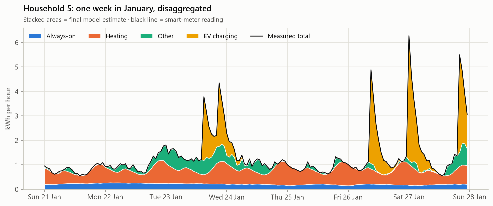
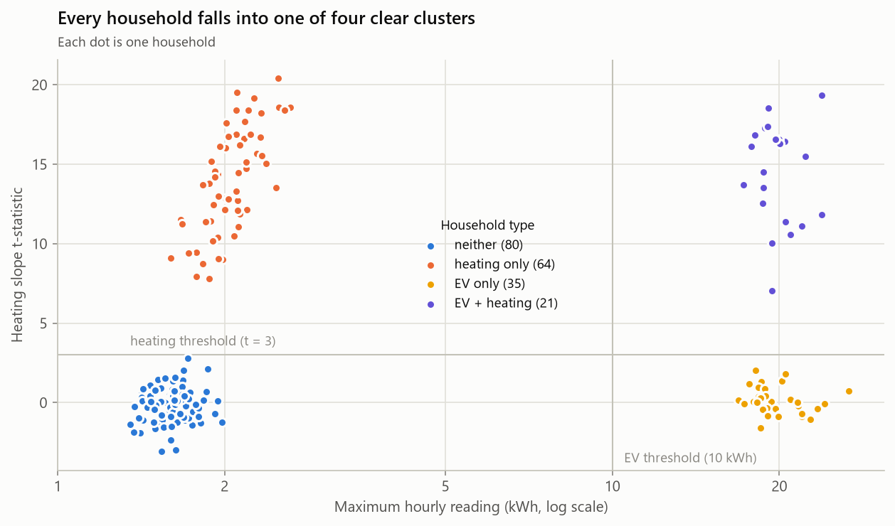
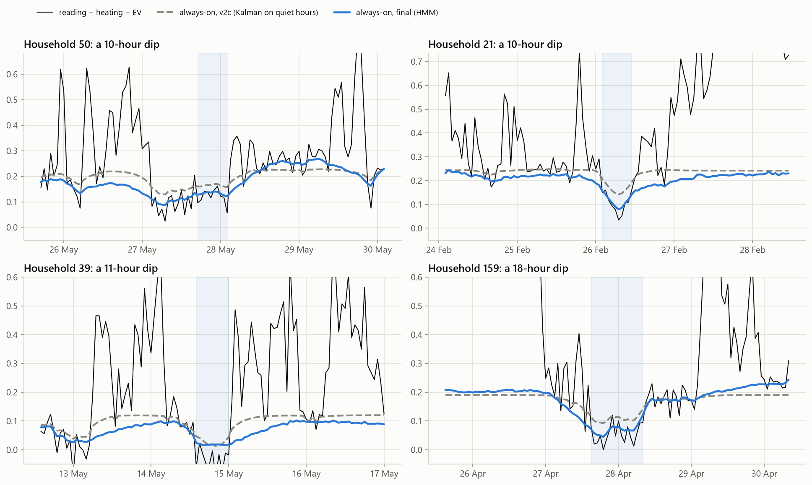
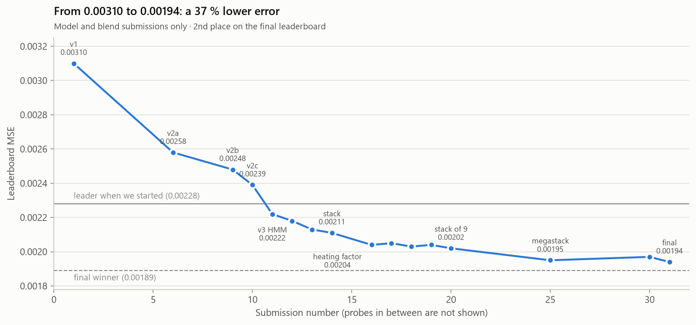
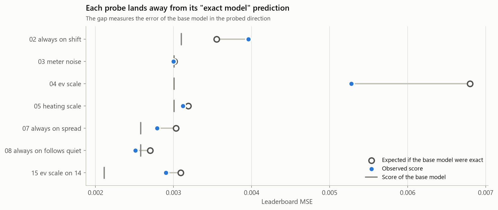

# Unsupervised NILM: Disaggregating Household Smart-Meter Data

**Non-intrusive load monitoring (NILM) of 200 households, without labels.**
A smart meter reports one number per hour. This project works out which part of that number was
**always-on devices**, **electric heating**, **EV charging** and **other** activity, using **no labels at all**.

Built for the Kaggle competition in DTU course *46765 Machine Learning for Energy Systems* (autumn 2026).
Final leaderboard MSE **0.00194**, **2nd place** (first model: 0.00310; winner: 0.00189).



## The approach in one paragraph

With no ground truth to train on, the model is built by **reverse-engineering the data-generating process**.
Each component follows a simple rule; once those rules are pinned down, disaggregation becomes estimation.
Three tools did the pinning down: **leaderboard probes** (MSE is quadratic, so a carefully designed submission
measures one inner product with the hidden truth), a **calibrated simulator** (score the model where the truth
is known; the real-vs-simulated statistic that disagrees reveals the missing rule), and the **likelihood of the
observed data** (choose model settings without labels or submissions). Two late steps mattered most: a **common
daily heating factor**, invisible in any one household but clear when residuals are averaged across the 85
heating households, and the **megastack**, which blends every scored submission (probes included) while treating
the 5-decimal rounding of the scores as measurement noise.

## What the data revealed

| Component | Rule recovered from the data | Evidence |
|---|---|---|
| **EV charging** | Sharp start, then a learned decay (~0.70/h) that ends after ~16 h; the first hour is often partial | [kernel](figures/ev_learned_kernel.png) · [tail](figures/ev_tail.png) |
| **Heating** | `k_h · max(0, 20.5 − T_daily) · profile(hour, weekend)`, one scale per household, **plus a random shock shared by all heating households** that appears each midnight and fades over the day (~10–18 % of heating) | [heating](figures/heating.png) · [daily factor](figures/heating_factor.png) |
| **Other** | Bursts of activity with memory: a clipped AR(1) process, φ ≈ 0.90; Mondays still partly weekend-like, public holidays ignored | [other](figures/other.png) · [weekdays](figures/weekdays.png) |
| **Always-on** | A per-household level **plus a slow drift** (sd ≈ 0.055 kWh, memory ~half a day), right at every time scale | [drift](figures/hmm_drift.png) |
| **Meter noise** | White noise, σ ≈ 0.036 kWh, that belongs to **no** component | probe 03 |



## The model

1. **Classify households** (EV: maximum reading; heating: *t*-statistic of a temperature regressor). A Gaussian
   mixture on the same two features agrees exactly.
2. **Heating and EV by regression** per household, prewhitened for AR(1) noise, with a learned EV session kernel and
   a ridge-shrunk second amplitude for each session's tail.
3. **Always-on and other by a grid hidden Markov model**: two hidden AR(1) chains (always-on drift, latent activity),
   censored zeros, forward–backward posterior means, EM-style re-estimation of household parameters. Settings chosen
   by maximum likelihood on the real readings.
4. **Common daily heating factor**: the heating-weighted cross-household mean of the residuals, Wiener-filtered
   day by day, added to every heating household.
5. **Megastack**: every scored submission, models and probes, blended with the weights that minimise the (exactly
   quadratic) MSE, keeping only the eigen-directions measured above the rounding noise of the scores. The final
   submission also removes an always-on bias in EV charging hours.



## Results

| Version | Idea | Leaderboard MSE |
|---|---|---|
| v1 | EV deconvolution + per-household GLS + KDE floor | 0.00310 |
| v2a | Learned EV kernel, probe-calibrated always-on and heating, meter noise removed, feasibility projection | 0.00258 |
| v2b | + always-on fluctuation (Kalman on quiet hours), household levels shrunk 13 % | 0.00248 |
| v2c | + ridge-shrunk tail amplitude per EV session | 0.00239 |
| v3 | + grid HMM for always-on (level + slow drift) and other | 0.00222 |
| v4 | HMM settings chosen by maximum likelihood | 0.00213 |
| stack | Optimal blend of the scored models | 0.00211 |
| + factor | Common daily heating factor added to the stack | 0.00204 |
| stack of 9 | Blend of all nine scored models (v5, v6: factor inside the HMM) | 0.00202 |
| megastack | Blend of all 24 scored files, probes included | 0.00195 |
| **final** | **Megastack of 30 files + always-on de-biasing in EV charging hours** | **0.00194** |



Between versions, **leaderboard probes** (submissions designed as measurements, not as predictions) located the
model's biases. The full log, with the question each probe answered, is in
[`results/leaderboard.csv`](results/leaderboard.csv).



## Repository layout

```
├── notebooks/unsupervised_nilm.ipynb   ← the full story, with a lesson per section (start here)
├── src/
│   ├── data.py           loading, caching, quality checks, calendar features
│   ├── disaggregate.py   the model, versions v1 → v6
│   ├── hmm.py            grid HMM: posterior means, log-likelihood, EM block fit
│   ├── hmm_variants.py   HMM with hour-varying settings (last-day likelihood tests, v7)
│   ├── common_factor.py  the common daily heating factor (cross-household mean + Wiener filter)
│   ├── simulate.py       simulator calibrated to the findings (known ground truth)
│   ├── tune_hmm.py       HMM settings by maximum likelihood on real households
│   ├── stack.py          leaderboard stacking (exact quadratic algebra)
│   ├── megastack.py      blend of every scored file, eigen-directions above the rounding noise
│   ├── make_probe.py     calibration probes (sum-preserving moves between components)
│   ├── make_final.py     the final submission (31)
│   ├── run_v3.py         fits any version on the real data (HMM in 4 parallel processes) and caches it
│   ├── make_stack.py     rebuilds a stacked submission from cached models
│   ├── make_common_heating.py  adds the heating factor to a cached prediction
│   ├── run_sim_v4.py     scores v4 on the simulator
│   ├── insights.py       analysis helpers behind the notebook figures
│   ├── probes.py         probe algebra helpers
│   ├── submission.py     builds and validates Kaggle files (numbered in upload order)
│   └── viz.py            plotting style (one fixed colour per component)
├── results/              leaderboard log and HMM likelihood tuning results
├── figures/              figures exported by the notebook
├── data/                 competition data (not included, see data/README.md)
└── submissions/          generated submission files (not tracked)
```

## Reproduce

```bash
pip install -r requirements.txt
# put kaggle_clustering_student_version.csv in data/ (see data/README.md)
cd src
python run_v3.py v2a; python run_v3.py v2b; python run_v3.py v2c   # ~1 min each (any version works)
python run_v3.py v3                         # ~10-15 min (HMM in 4 processes)
python run_v3.py v4                         # ~10 min
python run_v3.py v5; python run_v3.py v6    # ~15 min each (common heating factor inside the HMM)
python make_stack.py v2c v3 v4 v2b v2a      # blend of the HMM-era models (submission 14)
python megastack.py --base=20 --save        # blend of every scored file (submission 25, when 01-24 were scored)
python make_final.py                        # final submission (31), needs files 01-30 scored
jupyter lab ../notebooks/unsupervised_nilm.ipynb
```
